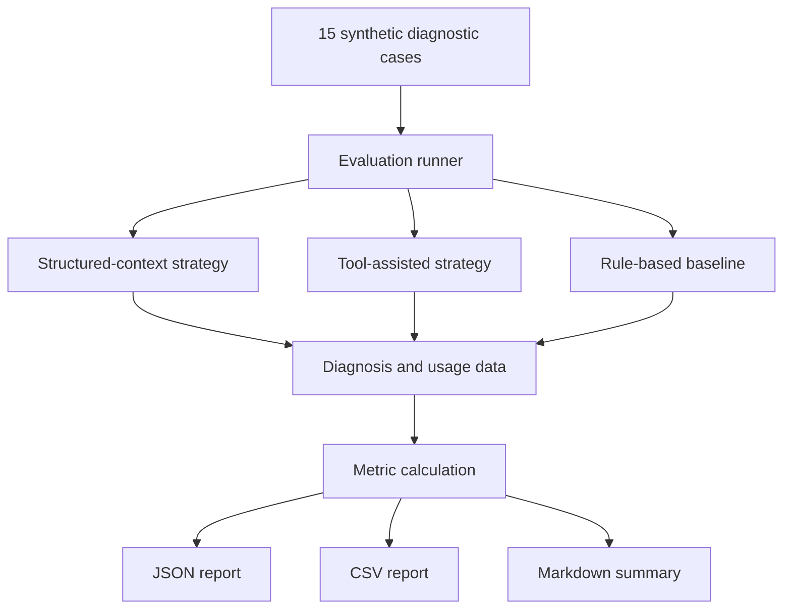

# AI-Assisted Debugging Evaluation Framework

A Python-based experimental framework for comparing approaches to diagnosing **synthetic application logs** with local large language models (LLMs).

The project examines the trade-offs between structured diagnostic context, bounded tool-assisted investigation and a deterministic rule-based baseline. It is an evaluation experiment—not a production incident-response system.

## At a glance

- **Language:** Python 3.10+
- **LLM runtime:** Ollama
- **Model options documented:** Llama 3.2 3B and 1B
- **Evaluation set:** 15 hand-authored synthetic cases across five root-cause categories
- **Reports:** JSON, CSV and Markdown
- **Tests:** Python `unittest`; core tests can run offline

## What it compares

| Strategy | How it works | What it helps examine |
|---|---|---|
| Structured-context LLM | Python extracts relevant evidence and supplies structured context to the model | Whether curated context supports diagnosis |
| Tool-assisted LLM | The model can request bounded, read-only inspection of supplied log text | Whether evidence gathering changes diagnosis quality and cost |
| Rule-based baseline | Transparent keyword matching assigns a root-cause label | A deterministic reference point without LLM inference |

## Architecture



The tool-assisted path only inspects the case's supplied in-memory log text. It does not execute shell commands, connect to devices or access production systems.

## Evaluation dimensions

| Measure | Meaning |
|---|---|
| Exact-match accuracy | Normalized predicted root-cause label matches the expected label |
| Completeness | Diagnosis is not `UNKNOWN`, includes an explanation and includes at least one recommended action |
| Latency | Mean, median and p95 execution time |
| Token usage | Prompt and completion token counters returned by Ollama |
| Tool usage | Number of inspection-tool calls |
| Reliability signals | Parsing failures and execution failures |

The dataset contains three cases for each of five categories. Results should always be interpreted in the context of this small synthetic dataset.

## Requirements

- Python 3.10 or newer
- Ollama installed and running for LLM strategies
- A locally available Llama 3.2 model

The project uses Python standard-library modules for its application code and tests; Ollama is an external runtime dependency for LLM-backed runs.

## Run locally

### 1. Clone and enter the repository

```bash
git clone https://github.com/Sochjvmbcht/ai-assisted-debugging-evaluation-2.git
cd ai-assisted-debugging-evaluation-2
```

### 2. Create a virtual environment

```bash
python3 -m venv .venv
source .venv/bin/activate
# Windows PowerShell: .venv\Scripts\Activate.ps1
```

### 3. Prepare Ollama

```bash
ollama pull llama3.2:3b
ollama serve
```

If Ollama is already running as a background service, the separate `ollama serve` command is unnecessary.

### 4. Run tests

```bash
python -m unittest discover -s tests -v
```

### 5. Run the full comparison

```bash
python -m debugging_eval --strategy all --model llama3.2:3b --timeout 60
```

Run an individual strategy:

```bash
python -m debugging_eval --strategy structured
python -m debugging_eval --strategy tool_assisted
python -m debugging_eval --strategy rule_based
```

The rule-based baseline does not require Ollama.

### Configure tool calls

The tool-assisted strategy accepts a maximum of zero, one or two inspection-tool calls:

```bash
python -m debugging_eval --strategy tool_assisted --max-tool-calls 0
python -m debugging_eval --strategy tool_assisted --max-tool-calls 1
python -m debugging_eval --strategy tool_assisted --max-tool-calls 2
```

Repeat the evaluation to observe run-to-run variation:

```bash
python -m debugging_eval --strategy all --repeats 2
```

## Output

An evaluation writes report files to the configured output directory (default: `reports/`):

- `latest.json` — per-case results and evaluation metadata
- `latest.csv` — tabular results for further analysis
- `summary.md` — strategy-level summary

Generated reports may be overwritten by subsequent runs. Preserve copies separately if you need to compare experiments over time.

## Repository layout

```text
.
├── debugging_eval/   # CLI, Ollama client, prompts, strategies and evaluator
├── data/             # Synthetic diagnostic cases
├── reports/          # Evaluation output
├── tests/            # Unit tests
├── .gitignore
├── LICENSE
└── README.md
```

## Limitations and responsible interpretation

- The evaluation set contains only 15 hand-authored synthetic cases.
- Synthetic logs are not a substitute for real production incidents, device logs or firmware diagnostics.
- The rule-based baseline is intentionally simple.
- LLM outputs can vary by model, prompt, runtime and hardware.
- Latency and token measurements are environment-dependent.
- Accuracy on this dataset does not establish reliability on real-world debugging tasks.

This is an independent educational project. It is not affiliated with Apple or any other device manufacturer and does not use proprietary firmware, real device coredumps or production debugging infrastructure.
